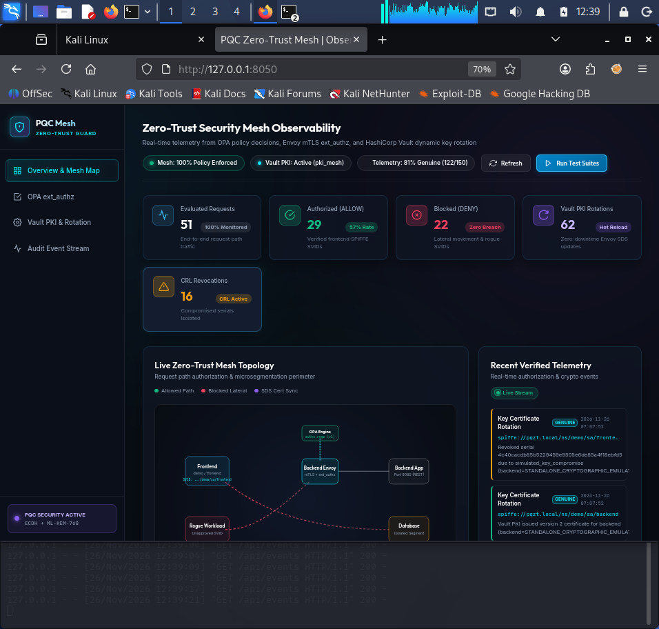
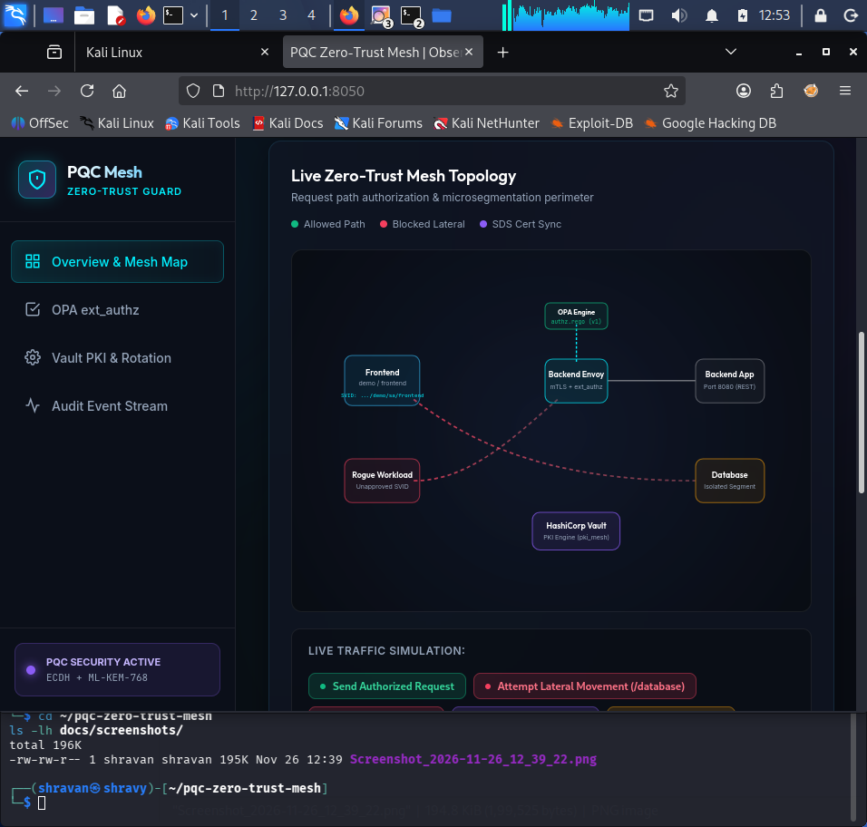
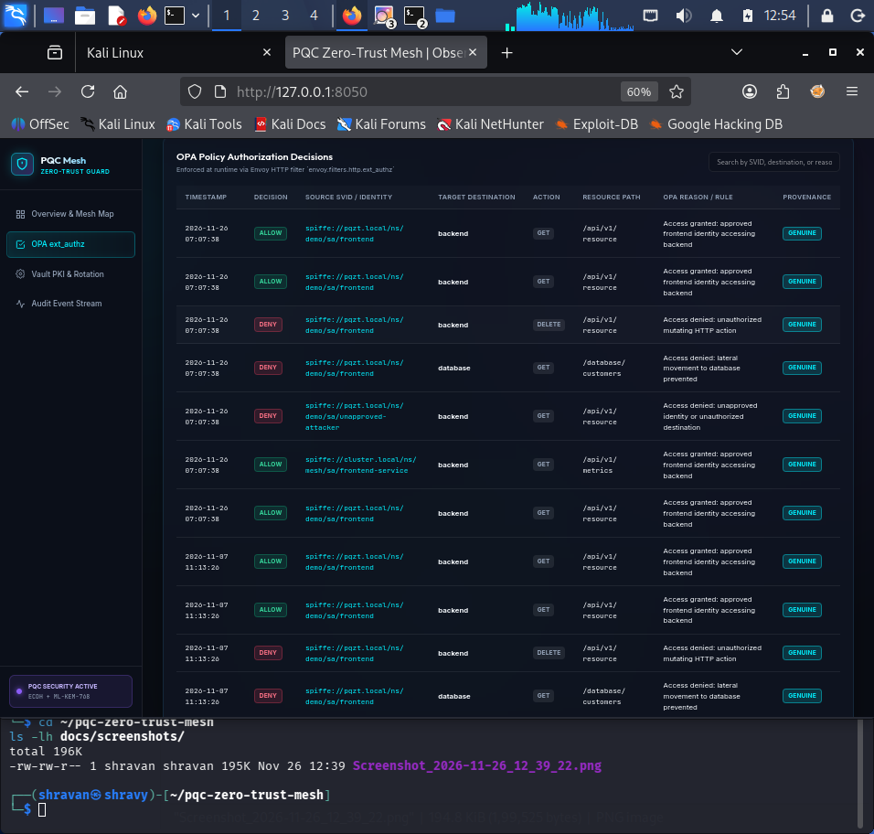
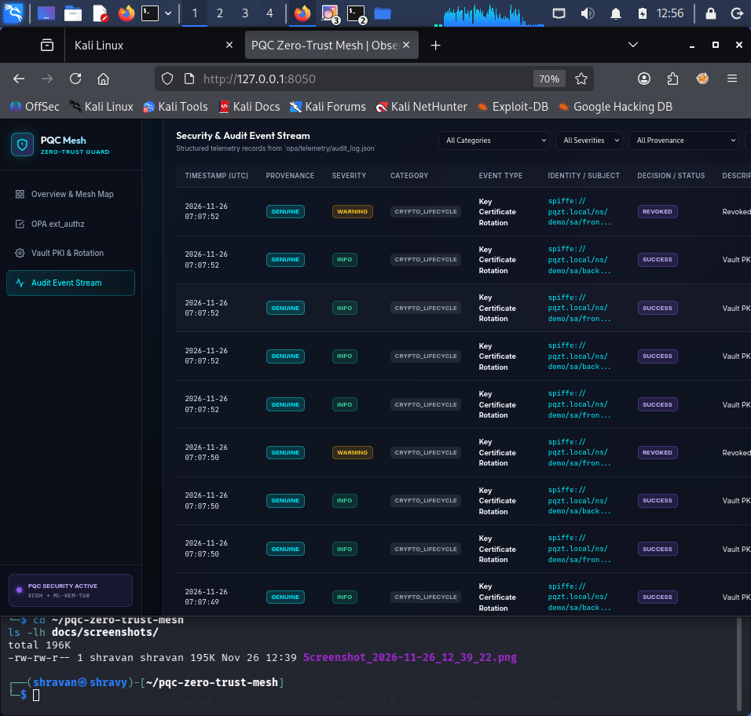
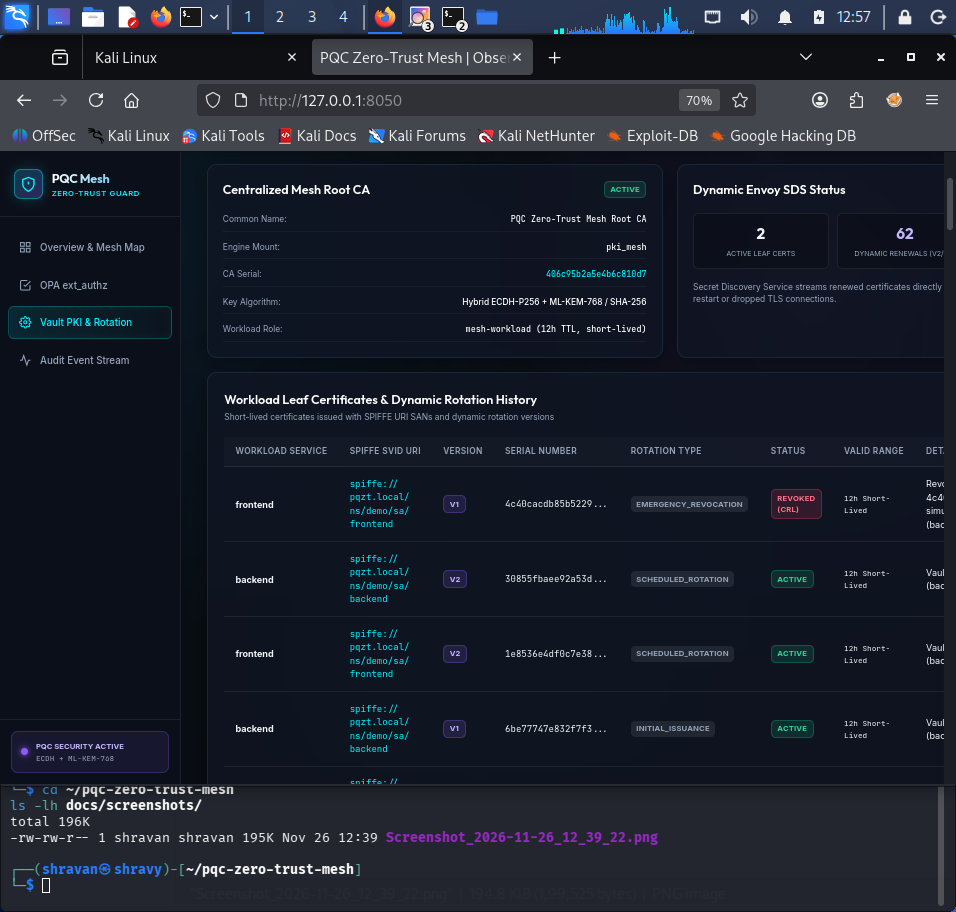

# Post-Quantum Zero-Trust Microsegmentation Mesh

[](https://github.com/kondlekarshravan216-crypto/pqc-zero-trust-mesh/actions/workflows/security-checks.yml)

**A zero-trust security project integrating workload identity, hybrid post-quantum key establishment, policy authorization, certificate lifecycle workflows, and security telemetry.**

[](https://www.python.org/)
[](https://www.openpolicyagent.org/)
[](https://www.rfc-editor.org/rfc/rfc8446)
[](#implementation-status-and-evidence)

> **Evidence-first status:** This repository contains working prototypes and dated verification artefacts. It is not a production-ready, fully integrated PQC Kubernetes service mesh. The current dashboard verification reports Vault in standalone cryptographic emulation mode; current live Vault health was not available on 26 November 2026. See the [implementation evidence](#implementation-status-and-evidence) and [final submission report](reports/FINAL_PROJECT_SUBMISSION_2026-11-26.md).

## Latest CI verification — 26 November 2026

GitHub Actions **Security and Integration Checks #11** passed on branch `main` at commit `b7eb4eb` (24 seconds, as shown by GitHub). The workflow covers Python and shell syntax, OPA unit and contract tests, static Envoy/Compose checks, Dashboard API security, Compose network isolation, PQC/Vault unit tests, and Docker Compose configuration validation. The workflow uses Python 3.12; the focused local checks recorded during final review used Python 3.13.12, OPA 1.21.4 and Docker Compose 2.40.3. [View workflow history](https://github.com/kondlekarshravan216-crypto/pqc-zero-trust-mesh/actions).

## At a glance

| Area | What is present | Evidence boundary |
|---|---|---|
| Zero-trust policy | Rego policies for frontend → backend → database authorization | Historical OPA unit/contract and service-path reports; rerun before claiming current pass |
| Workload identity and mTLS | SPIFFE-style URI SANs, TLS 1.3 Envoy configuration, local test CA scripts | Dated Envoy/mTLS evidence; some earlier tests used a TLS stand-in |
| Hybrid PQC | Python X25519 + ML-KEM-768 key-establishment prototype | Five recorded unit tests; dated packet captures show X25519MLKEM768 for specific tested handshakes |
| Certificate lifecycle | Vault API client/dual-mode PKI engine and emulation fallback | Current dashboard showed emulation mode; live Vault was not healthy during 26 Nov check |
| Kubernetes microsegmentation | Architecture and dated Minikube/NetworkPolicy demo artefacts | Not a currently reproducible clean-clone deployment; inspect dated evidence |
| Observability | Local dashboard with status, authorization and telemetry endpoints | Current local dashboard status checked 26 Nov 2026; telemetry includes historical and simulated events |

## Dashboard preview

The dashboard screenshots below are embedded directly in this README so visitors can see them on the repository landing page without opening the `docs/screenshots/` directory.

### 1. Dashboard overview


### 2. Mesh topology


### 3. OPA authorization


### 4. Security telemetry


### 5. Vault PKI status


[Open the complete screenshot directory](docs/screenshots/).

## Architecture

The intended workload path is:

```text
Frontend workload
    |
    | workload identity + TLS 1.3 mTLS
    v
Frontend Envoy
    |
    | authenticated service request
    v
Backend Envoy -----> OPA authorization decision
    |                    |
    | ALLOW               | DENY
    v                    v
Backend application   HTTP 403 / reject
    |
    | authorized backend-only access
    v
Database service
```

Kubernetes NetworkPolicies are intended to provide network-level segmentation around this application-level identity and authorization model. The above is the design/request path; not every component is currently deployed together in one reproducible Kubernetes environment.

## Main components

- **OPA:** Rego policies and unit/contract tests in `opa/policies/` and `tests/`.
- **Envoy and mTLS:** Proxy configurations in `envoy/`; local test CA scripts and extensions in `pki/`.
- **Hybrid key establishment:** Python prototype in `pqc/hybrid_kem.py`, combining X25519 and ML-KEM-768 secrets through a transcript-bound HKDF-SHA-256 derivation.
- **Vault PKI:** API client/coordinator, policies and development configuration in `vault/`.
- **Dashboard:** `dashboard/server.py`, static UI, and telemetry from `opa/telemetry/audit_log.json`.
- **Kubernetes and integration evidence:** Architecture, integration notes and dated test artefacts under `docs/` and `reports/`.

## Quick start: local dashboard

Requirements: Python 3.

```bash
git clone https://github.com/kondlekarshravan216-crypto/pqc-zero-trust-mesh.git
cd pqc-zero-trust-mesh

python3 -m venv .venv
source .venv/bin/activate
python3 -m pip install -r requirements.txt

# Start the local dashboard
bash dashboard/run_dashboard.sh
```

Open: **http://127.0.0.1:8050**

In a second terminal, inspect read-only endpoints:

```bash
curl -sS http://127.0.0.1:8050/api/status
curl -sS http://127.0.0.1:8050/api/events
```

The dashboard's `/api/evaluate-opa` endpoint runs the local OPA CLI when available and otherwise uses a Python policy fallback. Inspect the response `evaluator` field. Neither local evaluator mode is, by itself, a test of Envoy's gRPC `ext_authz` network path.

## Full-stack Compose setup

The Compose file expects these filenames in `CERT_DIR`:

- `frontend.crt` and `frontend-envoy.key`
- `backend.crt` and `backend-envoy.key`
- `ca.crt`

The hardened local PKI scripts create certificates in nested directories, so use the export helper to prepare the flat Compose bundle. These exported files are issued by the local ECDSA P-256 test CA; they are not automatically issued or rotated by Vault.

Requirements: Docker Engine, Docker Compose plugin, OpenSSL, OPA CLI (for policy checks), and the Python dependencies above.

```bash
# From the repository root
bash scripts/gen-ca.sh
bash scripts/issue-cert.sh frontend
bash scripts/issue-cert.sh backend
bash scripts/prepare-compose-certs.sh
```

The helper prints the exact `CERT_DIR`, `LOCAL_UID`, and `LOCAL_GID` values. Create `.env` only if it does not already exist; if it exists, edit it carefully rather than overwriting local settings.

Example for a fresh checkout:

```bash
if [ ! -f .env ]; then
  cat > .env <<EOF
CERT_DIR=$PWD/pki/out/compose-certs
LOCAL_UID=$(id -u)
LOCAL_GID=$(id -g)
EOF
else
  echo ".env already exists; review CERT_DIR, LOCAL_UID and LOCAL_GID manually."
fi

docker compose config
docker compose up -d
docker compose ps
```

The `.env`, `pki/out/`, CA private key and leaf private keys must remain untracked. The local development Vault configuration is not a production deployment profile.

## Focused test commands

Run the checks that match the component you changed:

```bash
# Rego unit tests (requires OPA CLI)
opa test opa/policies/ -v

# OPA contract tests (requires OPA CLI)
bash tests/test_opa.sh

# Dashboard API safety regressions
python3 tests/test_dashboard_api_security.py

# Compose network isolation regression checks
python3 tests/test_compose_network_isolation.py

# Hybrid key-establishment unit tests
pytest -q tests/pqc/test_hybrid_kem.py
```

The service-path and Vault suites should be run only after their documented local services/prerequisites are available. Their dated report files are historical results, not a substitute for a fresh run.

## Implementation status and evidence

### Historical automated verification

The dated [OPA/Vault/Dashboard verification report from 5 November 2026](reports/opa-vault-dashboard-verification-20261105.md) records **61/61 checks passed** across the suites listed in that report. Those results are historical and are not a fresh test run on 26 November.

Other dated artefacts include:

- [Hybrid PQC integration validation](reports/pqc-evidence/validation-report.md)
- [Captured hybrid key-share summary](reports/pqc-evidence/hybrid-keyshare.txt)
- [Envoy/mTLS validation log](reports/live-envoy-mtls-validation.txt)
- [Kubernetes microsegmentation demo log](reports/live-kubernetes-demo-20261030.txt)
- [OPA and secret-management verification](docs/AUTHORIZATION_AND_SECRET_MANAGEMENT_VERIFICATION.md)

### Current dashboard check — 26 November 2026

The local `/api/status` response reported:

- Dashboard: `healthy`
- OPA CLI installed: `true` (installation check only)
- Telemetry events: 150 total — 97 genuine-tagged and 53 simulated-tagged
- Vault engine: `STANDALONE_CRYPTOGRAPHIC_EMULATION`
- Live Vault health: `false`

The stored telemetry contains historic records and simulated events. Event counts are not a real-time threat rate or proof of newly generated live traffic.

## Cryptographic scope: important distinction

- The Python prototype combines X25519 and ML-KEM-768 and derives a 32-byte key using HKDF-SHA-256.
- Dated packet-capture reports record the hybrid TLS 1.3 group `X25519MLKEM768` in specific test handshakes. This does not prove every service connection or every deployment negotiates that group.
- The current mTLS certificate profiles use ECDSA P-256. **ML-DSA certificate signatures are not implemented/verified in the current mTLS certificate chain.**
- A dashboard label or algorithm name alone is not cryptographic handshake evidence. Use the packet capture and exact test context when making a PQC claim.

## Project documentation

| Resource | Description |
|---|---|
| [Final submission report](reports/FINAL_PROJECT_SUBMISSION_2026-11-26.md) | Current submission summary, dashboard evidence and limitations |
| [Architecture v1](docs/architecture/architecture-v1.md) | High-level architecture and intended request flow |
| [OPA integration contract](docs/architecture/opa-integration-contract.md) | Authorization contract |
| [Integration notes](docs/INTEGRATION.md) | Cross-component status and evidence boundaries |
| [Vault documentation](vault/README.md) | Vault policies, dev configuration and PKI workflow |
| [OPA documentation](opa/README.md) | Rego policies and tests |
| [Team status](TEAM_STATUS.md) | Team workstream and pending items |

## Repository layout

```text
.
├── backend/          # Demo backend service
├── dashboard/        # Local security observability dashboard
├── docs/             # Architecture, integration and screenshots
├── envoy/            # Envoy proxy configurations
├── opa/              # Rego policies and telemetry data
├── pki/              # Local test CA extensions and scripts
├── pqc/              # Hybrid key-establishment prototype
├── reports/          # Dated validation and submission reports
├── tests/            # Policy, service-path, PKI and PQC tests
└── vault/            # Vault development configuration and PKI tooling
```

## Disclaimer

This repository contains a zero-trust security implementation with multiple component-level integrations and verification artefacts. Production deployment requires environment-specific integration, independent security review, hardened key management, reproducible end-to-end tests, monitoring, and operational controls.
