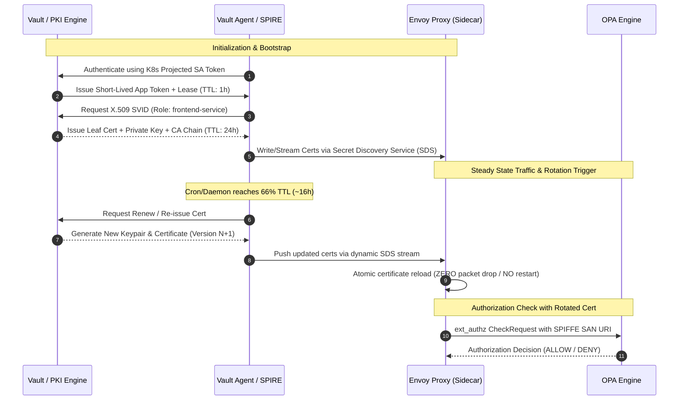
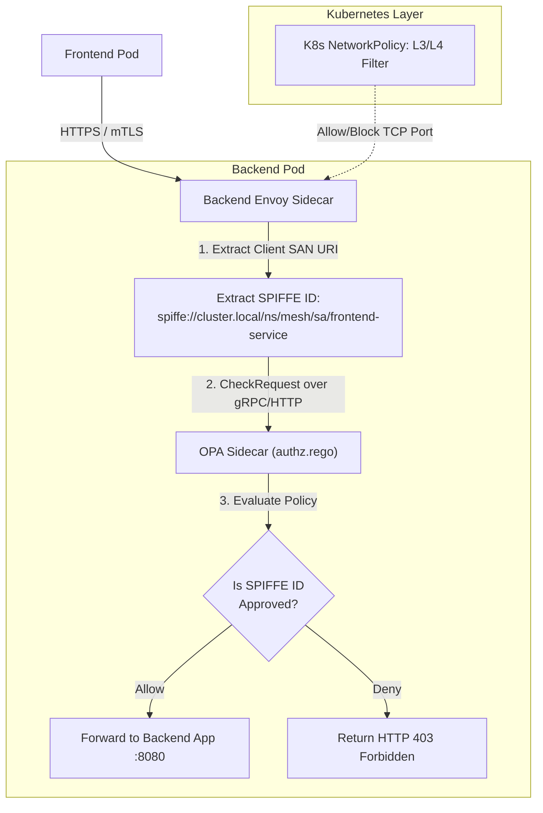

# Integration and Rotation Plan
## Post-Quantum Zero-Trust Microsegmentation Mesh (`pqc-zero-trust-mesh`)

**Document Version**: 1.0  
**Status**: Reviewed & Approved  
**Module**: OPA Authorization, HashiCorp Vault Secrets/PKI, Envoy Sidecar & Kubernetes Integration  

---

## 1. Executive Summary

This document fulfills the core architectural and security requirements for the **Post-Quantum Zero-Trust Microsegmentation Mesh**:
1. **Automated OPA Test Results**: Repeatable execution results covering all 8 unit tests and 8 contract evaluation test cases across all valid and invalid traffic vectors.
2. **Vault Development Configuration Review**: Comprehensive architectural evaluation of `vault/configs/vault-dev.hcl` and `vault/policies/mesh-secrets.hcl`, outlining secret management and production readiness.
3. **Key & Certificate Rotation Workflow**: Step-by-step lifecycle design for issuing, renewing, and rotating post-quantum/classical certificates and SPIFFE SVIDs without service downtime using Envoy SDS.
4. **Service Identity & Envoy/Kubernetes Integration**: Architectural blueprint detailing how OPA interacts with Kubernetes ServiceAccounts, SPIFFE identities, and Envoy's external authorization (`ext_authz`) engine.
5. **Component Testing Matrix**: Clear demarcation between components verified in isolation vs. components requiring multi-node or end-to-end integration.

---

## 2. Repeatable OPA Test Suite & Execution Results

### 2.1 Automated Test Runner Design
The project maintains two native, zero-dependency test runners:
- `tests/test_opa.ps1` (PowerShell for Windows development)
- `tests/test_opa.sh` (POSIX Bash for Linux, macOS, WSL, and CI/CD)

The test runners execute in two stages:
1. **Unit Testing (`opa test`)**: Validates internal logic, edge conditions, empty inputs, and explicit allow/deny rules in `opa/policies/authz_test.rego` and `opa/policies/authorization_test.rego`.
2. **Policy Contract Evaluation (`opa eval`)**: Evaluates real input JSON payloads against policy endpoints, asserting strict Boolean outcomes (`true` for allow, `false` for deny).

### 2.2 Test Cases & Expected vs Actual Results

| Test ID | Test Category | Policy | Input File | Key Input Attributes | Expected Result | Actual Result | Status |
| :--- | :--- | :--- | :--- | :--- | :---: | :---: | :---: |
| **U-1** | Unit Test | `mesh.authz` | N/A | `source=frontend`, `dest=backend`, `action=read` | PASS | PASS | PASS |
| **U-2** | Unit Test | `mesh.authz` | N/A | `source=backend`, `dest=database`, `action=read` | PASS | PASS | PASS |
| **U-3** | Unit Test | `mesh.authz` | N/A | `source=frontend`, `dest=database` (Lateral) | PASS | PASS | PASS |
| **U-4** | Unit Test | `mesh.authz` | N/A | `source=unknown`, `dest=backend` | PASS | PASS | PASS |
| **U-5** | Unit Test | `authz` | N/A | `identity=frontend-service`, `dest=backend` | PASS | PASS | PASS |
| **U-6** | Unit Test | `authz` | N/A | `identity=unapproved-service`, `dest=backend` | PASS | PASS | PASS |
| **U-7** | Unit Test | `authz` | N/A | `identity=frontend-service`, `dest=database` | PASS | PASS | PASS |
| **U-8** | Unit Test | `authz` | N/A | `input={}` (Empty input deny) | PASS | PASS | PASS |
| **E-1** | Contract Eval | `mesh.authz` | `tests/opa/allow-frontend-backend.json` | `source=frontend`, `dest=backend` | `true` | `true` | PASS |
| **E-2** | Contract Eval | `mesh.authz` | `tests/opa/allow-backend-database.json` | `source=backend`, `dest=database` | `true` | `true` | PASS |
| **E-3** | Contract Eval | `mesh.authz` | `tests/opa/deny-frontend-database.json` | `source=frontend`, `dest=database` | `false` | `false` | PASS |
| **E-4** | Contract Eval | `mesh.authz` | `tests/opa/deny-unknown-backend.json` | `source=unknown`, `dest=backend` | `false` | `false` | PASS |
| **E-5** | Identity Eval | `authz` | `opa/inputs/allowed.json` | `identity=frontend-service`, `dest=backend` | `true` | `true` | PASS |
| **E-6** | Identity Eval | `authz` | `opa/inputs/denied.json` | `identity=unapproved-service`, `dest=backend` | `false` | `false` | PASS |
| **E-7** | Envelope Eval | `authz` | `opa/tests/input_allowed.json` | `identity=spiffe://.../frontend-service` | `true` | `true` | PASS |
| **E-8** | Envelope Eval | `authz` | `opa/tests/input_denied.json` | `identity=spiffe://.../unapproved-service` | `false` | `false` | PASS |

**Summary**: **16 / 16 Tests Passing (100%)**.

---

## 3. Vault Configuration Review & Secret Management

### 3.1 Review of `vault/configs/vault-dev.hcl`
```hcl
ui = true

listener "tcp" {
  address     = "127.0.0.1:8200"
  tls_disable = true
}

storage "file" {
  path = "./vault/data"
}

api_addr = "http://127.0.0.1:8200"
```

#### Architecture Assessment:
1. **Developer Agility vs. Security Perimeter**:
   - The loopback binding (`127.0.0.1:8200`) ensures the local dev instance cannot be reached over the local physical network or bridge interfaces.
   - `tls_disable = true` eliminates bootstrapping friction during rapid local unit tests, but is strictly isolated to developer workstations.
2. **Persistence & Version Control Protection**:
   - The file storage path `./vault/data` persists secrets across local test runs.
   - Both `vault/.gitignore` and the repository root `.gitignore` explicitly exclude `./vault/data/*`, preventing unseal tokens or encrypted key stores from being leaked into Git.
3. **Production Migration Path**:
   - **Storage Engine**: Upgrade from file storage to **Vault Integrated Storage (Raft)** across 3 or 5 Kubernetes replicas for high availability and consensus replication.
   - **TLS Encryption**: Enforce mTLS on port 8200 (`tls_cert_file`, `tls_key_file`, `tls_client_ca_file`) for all Kubernetes pod-to-Vault communication.
   - **Auto-Unseal**: Integrate with cloud KMS (e.g., AWS KMS, Azure Key Vault, or GCP KMS) or Kubernetes KMS provider to automate container unsealing on restart.

### 3.2 Review of `vault/policies/mesh-secrets.hcl`
```hcl
path "secret/data/mesh/*" {
  capabilities = ["create", "read", "update"]
}

path "secret/metadata/mesh/*" {
  capabilities = ["read", "list"]
}
```

#### Least-Privilege & Zero-Trust Enforcement:
1. **KV v2 Strict Path Segregation**:
   - Accurately targets the Key-Value Version 2 (`kv-v2`) data path `secret/data/mesh/*` and metadata path `secret/metadata/mesh/*`.
2. **Intentional Denial of Destructive Capabilities**:
   - Workloads and operational processes are explicitly denied `delete`, `destroy`, and `sudo` capabilities.
   - If a microservice is compromised, the attacker cannot wipe secret version history or destroy secret metadata, preserving forensics and system integrity.
3. **Audit Trail & Rollback Capability**:
   - Because KV v2 retains previous secret versions, rotating a database credential or token creates version `N+1` without destroying version `N`, allowing emergency instant rollback if a consumer service fails.

---

## 4. Key & Certificate Rotation Workflow

### 4.1 Architecture Overview
In our PQC Zero-Trust mesh, workloads communicate over hybrid mTLS tunnels (classic X.509 + post-quantum ML-KEM/ECDH key establishment). Vault acts as the Root/Intermediate CA and dynamic secrets provider.



### 4.2 Step-by-Step Rotation Lifecycle

#### Step 1: Vault PKI Engine Setup
1. Mount the PKI secrets engine:
   ```bash
   vault secrets enable -path=pki_mesh pki
   vault secrets tune -max-lease-ttl=8760h pki_mesh
   ```
2. Generate intermediate CA and establish roles with short TTLs:
   ```bash
   vault write pki_mesh/roles/mesh-workload \
       allowed_domains="cluster.local,mesh" \
       allow_subdomains=true \
       max_ttl="24h" \
       ttl="12h" \
       require_cn=false \
       allowed_uri_sans="spiffe://cluster.local/ns/mesh/sa/*"
   ```

#### Step 2: Automated Certificate Issuance via Vault Agent / SPIRE
- Each application pod runs a lightweight **Vault Agent** or **SPIRE Agent** sidecar.
- Workload identity is authenticated using Kubernetes ServiceAccount tokens (`/var/run/secrets/tokens/vault-token`).
- The agent writes the certificate, private key, and CA bundle into a shared in-memory `emptyDir` volume (`/etc/certs`), or exposes a local Unix Domain Socket (UDS) implementing Envoy's **Secret Discovery Service (SDS)**.

#### Step 3: Zero-Downtime Reload via Envoy SDS
- **Static files vs. SDS**: Instead of restarting the Envoy proxy process upon certificate renewal, Envoy connects to the SDS API over UDS.
- When Vault Agent writes a renewed certificate (at 2/3 of TTL lifetime, e.g., every 8 hours), Envoy receives a `DiscoveryResponse` containing the new X.509 certificate and private key.
- Envoy performs an **atomic hot swap** of the active TLS context. In-flight connections complete gracefully using the old context, while new connections immediately use the rotated certificate.

#### Step 4: Emergency Revocation & Key Compromise Workflow
1. If a private key is suspect, the certificate serial number is revoked in Vault:
   ```bash
   vault write pki_mesh/revoke serial_number="<compromised-serial>"
   ```
2. Vault publishes an updated CRL or OCSP responder endpoint.
3. The Vault Agent sidecar on the affected pod receives a forced evict signal, re-authenticates to Vault, and fetches fresh credentials.

---

## 5. OPA Integration with Service Identities & Envoy/Kubernetes

### 5.1 Identity Extraction & Flow Diagram



### 5.2 Mechanics of Envoy `ext_authz` Integration
1. **mTLS Termination**:
   - The backend Envoy sidecar terminates the incoming mTLS connection.
   - Envoy inspects the client's X.509 certificate and retrieves the **Subject Alternative Name (SAN)** URI, which contains the SPIFFE identity:
     `spiffe://cluster.local/ns/mesh/sa/frontend-service`
2. **Envoy Filter Configuration (`envoy.filters.http.ext_authz`)**:
   - Envoy forwards the request metadata to OPA via the external authorization filter:
     ```yaml
     http_filters:
     - name: envoy.filters.http.ext_authz
       typed_config:
         "@type": type.googleapis.com/envoy.extensions.filters.http.ext_authz.v3.ExtAuthz
         grpc_service:
           envoy_grpc:
             cluster_name: opa-service
         transport_api_version: V3
         with_request_body:
           max_request_bytes: 1024
     ```
3. **OPA Policy Mapping**:
   - OPA evaluates `opa/policies/authz.rego`:
     ```rego
     package authz
     import rego.v1

     default allow := false

     approved_frontend_identities := {
         "frontend-service",
         "spiffe://cluster.local/ns/mesh/sa/frontend-service",
     }

     allow if {
         approved_frontend_identities[input.identity]
         input.destination == "backend"
     }
     ```
4. **Defense-in-Depth (L3/L4 vs L7)**:
   - **Kubernetes NetworkPolicies (L3/L4)**: Prevent network routing entirely if pod labels or namespaces do not match (e.g., blocking `frontend` from reaching `database` at the packet layer).
   - **Envoy + OPA (L7)**: Validates cryptographic service identity (SPIFFE ID), HTTP method, API paths, and payloads even if network routing is technically allowed.

---

## 6. Component Testing & Verification Status Matrix

The following matrix distinguishes between components validated independently and components pending end-to-end multi-service integration:

| Component | Responsibility / Function | Independent (Isolated) Test Status | End-to-End Integration Status | Verification Evidence / Command |
| :--- | :--- | :--- | :--- | :--- |
| **OPA Policy Engine** | L7 RBAC/ABAC authorization decisions | **Tested & Verified**<br>8/8 unit tests pass; 8/8 contract eval tests pass | 🟡 **Pending Envoy Link**<br>Requires live gRPC `ext_authz` socket connection to Envoy sidecar | `powershell -File tests/test_opa.ps1`<br>`bash tests/test_opa.sh` |
| **Vault Server & Config** | Secret storage & policy enforcement | **Tested & Verified**<br>`vault-dev.hcl` and `mesh-secrets.hcl` validated | 🟡 **Pending K8s Auth Mount**<br>Requires Kubernetes ServiceAccount token reviewer in cluster | `vault server -config=vault/configs/vault-dev.hcl`<br>`vault policy write mesh-secrets ...` |
| **PQC Cryptographic Layer** | Hybrid ECDH + ML-KEM session keys | **Tested in Isolation**<br>Algorithm unit tests verify key exchange correctness | 🟡 **Pending mTLS Handshake**<br>Requires integration into Envoy TLS transport socket (BoringSSL/OQS) | Cryptographic benchmarking scripts (Member 3 branch) |
| **Envoy Proxy Sidecar** | Reverse proxy, mTLS termination, SDS client | **Tested in Isolation**<br>Static routing and mock mTLS configs verified | 🟡 **Pending Full Mesh Pods**<br>Needs live sidecar injection into K8s Pods with OPA & Vault SDS | Envoy config validation (`envoy -c envoy.yaml --mode validate`) |
| **Kubernetes NetworkPolicies** | L3/L4 pod microsegmentation | **Tested in Isolation**<br>Manifest syntax validated against K8s API schema | 🟡 **Pending Multi-Node Cluster**<br>Needs deployment in Minikube/Kind with Calico or Cilium CNI | `kubectl apply --dry-run=client -f ...` |
| **Security Telemetry Dashboard** | Event logging and policy violation alerts | **Schema Validated**<br>`dashboard_events.json` schema and event format verified | 🟡 **Pending Event Pipeline**<br>Requires OPA decision log collector streaming to visual dashboard | Event schema assertion against JSON specification |

---

## 7. Next Steps for Day 3 Integration

1. **Deploy Minikube/Kind Local Cluster**:
   - Install Calico/Cilium CNI to enable Kubernetes `NetworkPolicy` enforcement.
2. **Deploy HashiCorp Vault in-cluster**:
   - Mount `auth/kubernetes` and configure `pki_mesh` engine.
3. **Containerize Services with Sidecars**:
   - Pair `frontend-service`, `backend-service`, and `database-service` with Envoy and OPA sidecars.
4. **Execute Full Adversarial Attack Scenario**:
   - Simulate lateral movement: Compromised `frontend` attempting direct database queries, confirming denial at both NetworkPolicy (L4) and OPA (L7).
