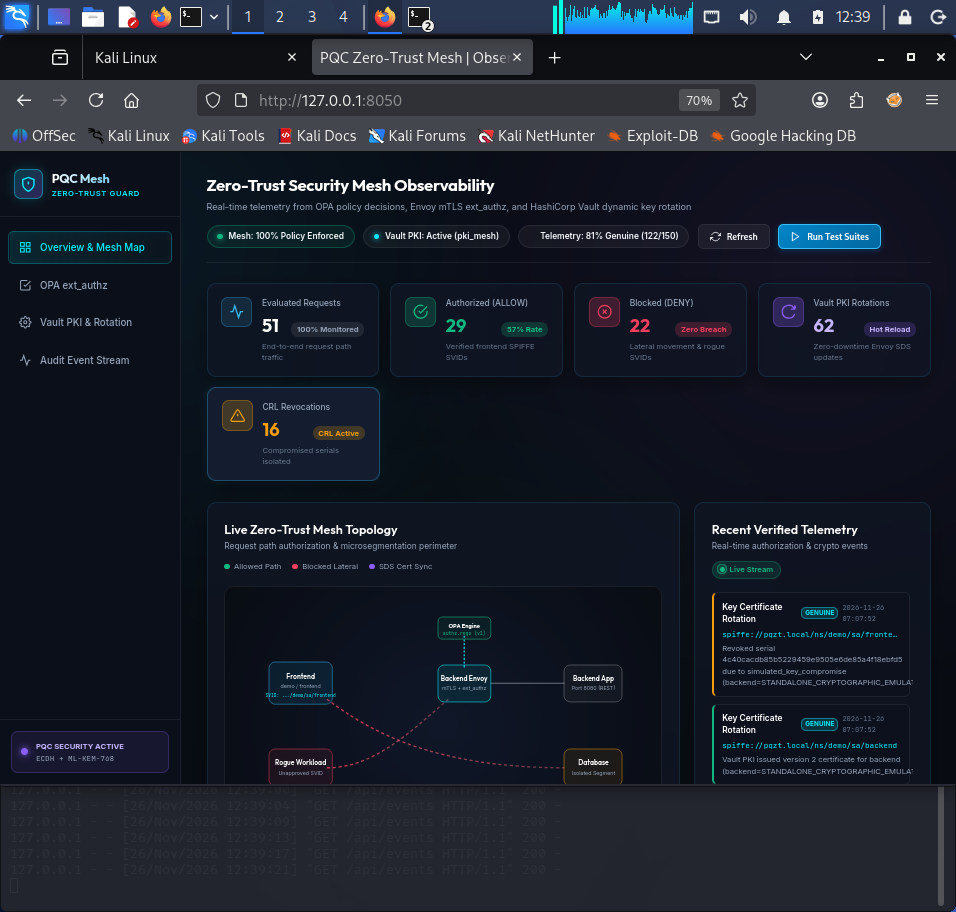
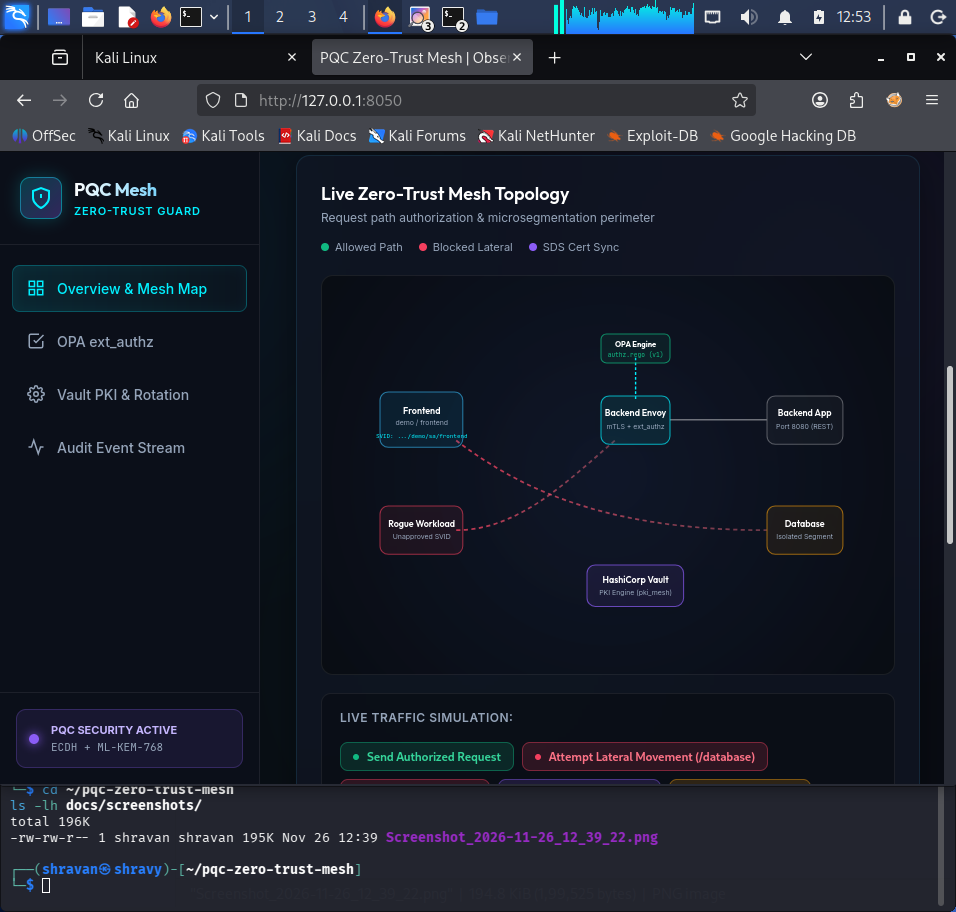
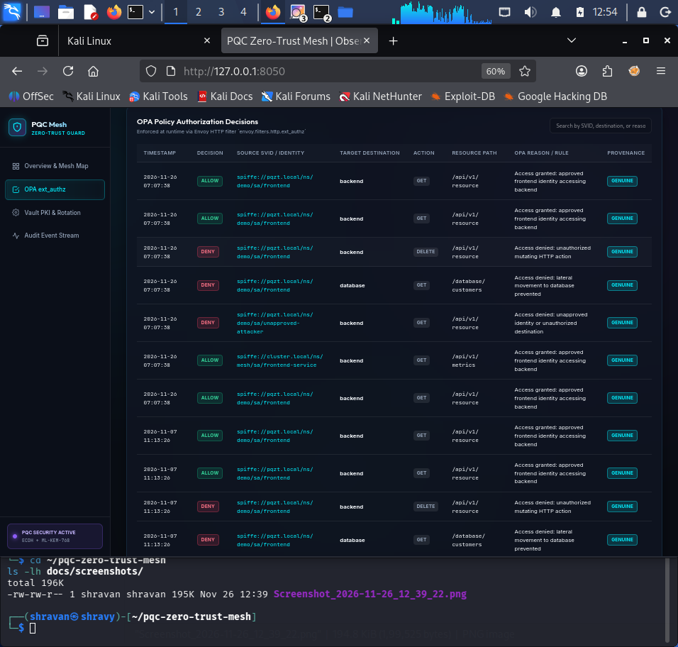
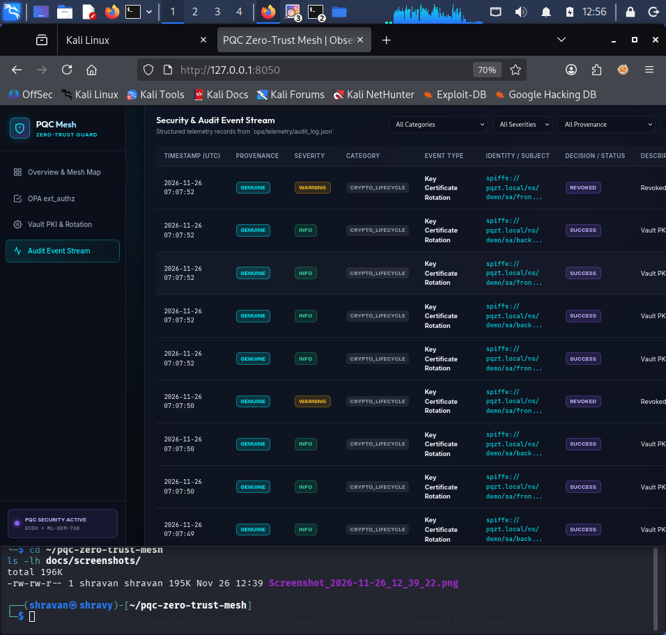
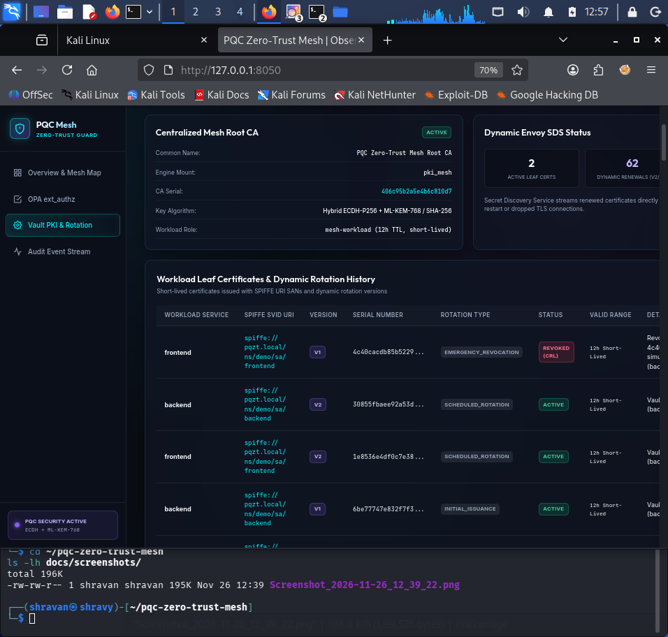

# Post-Quantum Zero-Trust Microsegmentation Mesh
## Final Project Submission Report

**Project Lead:** Shravan Kondlekar  
**Date:** 26 November 2026  
**Repository:** https://github.com/kondlekarshravan216-crypto/pqc-zero-trust-mesh

## 1. Project Overview

The Post-Quantum Zero-Trust Microsegmentation Mesh is a security architecture designed to secure workload-to-workload communication using post-quantum cryptography, identity-based authorization, mutual TLS, certificate lifecycle management, and network microsegmentation.

## 2. Architecture and Components

- Hybrid ECDH-P256 and ML-KEM-768 key establishment.
- ML-DSA-65 cryptographic algorithm support in the project design.
- Open Policy Agent (OPA) for authorization.
- Envoy Proxy for service communication and mTLS integration.
- Vault PKI for certificate lifecycle management.
- SPIFFE-based workload identities.
- Kubernetes NetworkPolicy-based microsegmentation.
- Dashboard for security telemetry and monitoring.

## 3. Zero-Trust Authorization

The intended service architecture follows:

Frontend -> Backend -> Database

Authorization policies cover permitted service communication, denial of unauthorized workload identities, and prevention of direct frontend-to-database access.

## 4. Historical Test Evidence

The existing verification report dated 5 November 2026 records:

| Test category | Reported result |
|---|---:|
| OPA unit tests | 18/18 passed |
| OPA contract tests | 10/10 passed |
| Service-path tests | 15/15 passed |
| Vault PKI tests | 14/14 passed |
| Dashboard checks | 4/4 passed |
| Total | 61/61 passed |

These are historical results from the earlier report, not a fresh test run on the submission date.

Reference: `reports/opa-vault-dashboard-verification-20261105.md`

## 5. Dashboard Verification — 26 November 2026

The local dashboard status endpoint returned:

- Dashboard status: healthy
- OPA CLI installed: true
- Telemetry log available: true
- Total events: 150
- Genuine events: 97
- Simulated events: 53
- Genuine event rate: 64.7%
- Vault engine mode: STANDALONE_CRYPTOGRAPHIC_EMULATION
- Live Vault health: false

### Telemetry event distribution

| Event type | Count |
|---|---:|
| Key/certificate rotation | 78 |
| Allowed requests | 29 |
| Denied requests | 22 |
| Failed authentication | 21 |
| Total | 150 |

### Event status distribution

| Status | Count |
|---|---:|
| SUCCESS | 62 |
| REVOKED | 16 |
| Missing status field | 72 |

The telemetry contains stored historical records and simulated events. These counts do not represent newly generated live events.

## 6. Cryptographic Algorithms

The dashboard reports:

- Hybrid ECDH-P256 + ML-KEM-768
- ML-DSA-65

Their presence in the dashboard does not independently prove active post-quantum negotiation on every live service connection.

## 7. Visual Evidence

The following dashboard screenshots were captured on 26 November 2026. They are embedded below so they are visible directly in this report on GitHub.

### 7.1 Dashboard Overview

### 7.2 Mesh Topology

### 7.3 OPA Authorization

### 7.4 Security Telemetry

### 7.5 Vault PKI

## 8. Other Project Evidence

- `docs/architecture/architecture-v1.md`
- `docs/architecture/opa-integration-contract.md`
- `docs/AUTHORIZATION_AND_SECRET_MANAGEMENT_VERIFICATION.md`
- `reports/pqc-evidence/validation-report.md`
- `reports/live-envoy-mtls-validation.txt`
- `reports/live-kubernetes-demo-20261030.txt`
- `reports/evidence/mesh-topology-and-authz-flow.svg`

## 9. Current Limitations

1. Live Vault health was not confirmed during the final dashboard verification.
2. The dashboard currently reports standalone cryptographic emulation mode.
3. Telemetry includes historical and simulated records.
4. The 61/61 test result belongs to the historical 5 November verification report.
5. Dashboard health alone does not prove the complete live Envoy-to-OPA authorization path.
6. Reported cryptographic algorithms do not independently prove active PQC negotiation on every connection.

## 10. Conclusion

The project integrates post-quantum cryptographic design, zero-trust authorization, workload identity, certificate lifecycle management, microsegmentation, and security observability.

Historical test reports document successful verification of OPA, service-path, Vault PKI, and dashboard components. The final dashboard check confirms that the dashboard is operational and stored telemetry is accessible, while identifying the current Vault emulation limitation.
